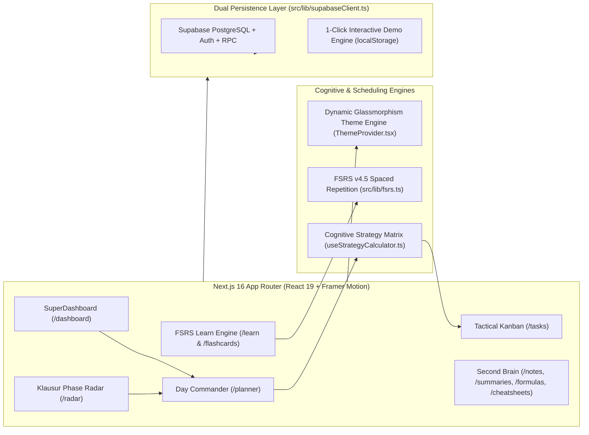

# ElectroBrain (`studentOS`) 🧠⚡

> **An AI-ready, cognitive-science-driven learning & productivity operating system for university students.**  
> Built with **Next.js 16 (App Router)**, **React 19**, **TypeScript**, **Tailwind CSS v4**, **Framer Motion**, and **Supabase**.

---

## ✨ Live Portfolio Demo Mode (Zero Config Required)

Recruiters and reviewers can explore the full application **without setting up a Supabase backend or creating an account**:
- Simply clone the repository and run `npm install && npm run dev` (or click **"Live Portfolio Demo (Ohne Login)"** on `/login`).
- When `NEXT_PUBLIC_SUPABASE_URL` is not set (or Demo Mode is toggled), `studentOS` automatically activates a **persistent `localStorage`-backed Demo Engine** pre-seeded with realistic Computer Science & Mathematics courses, FSRS flashcard decks, Cornell notes, LaTeX/scientific formulas, cheat sheets, exam deadlines, and Kanban missions.

---

## 🏗️ System Architecture & Core Modules



### 1. 🧠 FSRS v4.5 Spaced Repetition Engine ([`src/lib/fsrs.ts`](src/lib/fsrs.ts))
Implements the modern **Free Spaced Repetition Scheduler (FSRS v4.5)** memory model based on the *DSR* (Difficulty, Stability, Retrievability) framework:
- Computes memory **Stability ($S$)** and item **Difficulty ($D \in [1, 10]$)** dynamically across 4 card states (`New`, `Learning`, `Review`, `Relearning`).
- Models the exponential forgetting curve $R(t, S) = \left(1 + \text{FACTOR} \cdot \frac{t}{S}\right)^{\text{DECAY}}$ to schedule reviews at a target retention rate of $90\%$.

### 2. ⚡ Day Commander & Tactical Strategy Calculator ([`src/app/(app)/planner/page.tsx`](src/app/(app)/planner/page.tsx))
Prevents student decision fatigue by dividing the study day into two structured cognitive blocks:
- **Slot 01 (Morning Deep Work)** & **Slot 02 (Afternoon Consolidation)** with an integrated 50/30-minute execution timer and auto-saving Brain Dump.
- **Tactical Advisor ([`StrategyPrompt.tsx`](src/components/planner/StrategyPrompt.tsx) & [`useStrategyCalculator.ts`](src/hooks/useStrategyCalculator.ts))**: Evaluates 3 dimensions (*Current Knowledge Level × Available Time Window × Exam Deadline Urgency*) to prescribe one of 5 evidence-based study modes:
  - 🧭 **The Scout (`SQ3R`)** — Structural survey & 80/20 Pareto overview
  - ✍️ **The Scribe (`Cornell`)** — Lecture consolidation & cue-question synthesis
  - 🎙️ **The Teacher (`Feynman`)** — Out-loud conceptual explanation to expose knowledge gaps
  - 🧠 **The Tester (`Active Recall`)** — Closed-book FSRS retrieval practice
  - 🏋️ **The Gym (`Interleaved Practice`)** — Timed problem-solving & past exam simulation

### 3. 🎯 Klausur Phase Radar ([`src/app/(app)/radar/page.tsx`](src/app/(app)/radar/page.tsx))
Automatically transitions each upcoming exam through four scientific preparation phases based on remaining days:
- **Preparation (`> 21 days`)**: Understanding & summarizing core material
- **Memorizing (`21 – 8 days`)**: Active Recall & FSRS spaced repetition
- **Simulation (`7 – 4 days`)**: Full past exams under timed conditions
- **Panic / Pareto (`≤ 3 days`)**: High-yield 80/20 survival focus

### 4. 📚 Second Brain Knowledge Suite
- **Second Brain Notes (`/notes`)**: Markdown knowledge base with tag filtering, favorites, and soft-delete trash recovery.
- **Summaries (`/summaries`) & Cheat Sheets (`/cheatsheets`)**: Hierarchical folder organization (`Subject/Subtopic`) with GitHub-Flavored Markdown table rendering.
- **Formula Vault (`/formulas`) & NotebookLM JSON Sync**: Categorized formula directory with bulk JSON import support for AI-extracted formulas.
- **Prompt Library (`/prompts`)**: One-click copyable study prompt templates for LLMs.

### 5. 🎨 Dynamic Theme & Gamification System
- **Neural XP & Daily Quests**: Earn XP for completing study blocks, flashcards, and quests with animated level progression.
- **Multi-Theme Engine ([`ThemeProvider.tsx`](src/components/providers/ThemeProvider.tsx))**: Instant switching between `Modern`, `Dark`, `Pastel`, and user-defined `Custom Hex` CSS variable themes.

---

## 🛠️ Tech Stack

| Layer | Technologies |
| :--- | :--- |
| **Framework** | Next.js 16.1 (App Router, Turbopack), React 19, TypeScript 5 |
| **Styling & UI** | Tailwind CSS v4, Framer Motion 12, Lucide Icons, Canvas Confetti |
| **Markdown** | `react-markdown`, `remark-gfm`, `@tailwindcss/typography` |
| **Backend & Auth** | Supabase (`@supabase/supabase-js`, `@supabase/ssr`) + Offline Demo Engine |

---

## 🚀 Getting Started Locally

### 1. Install Dependencies
```bash
npm install
```

### 2. Run in Instant Demo Mode (No `.env` Needed)
```bash
npm run dev
```
Open `http://localhost:3005` — Demo Mode starts automatically with sample data.

### 3. (Optional) Connect Your Own Supabase Project
Create a `.env.local` file in the root directory:
```env
NEXT_PUBLIC_SUPABASE_URL=https://your-project.supabase.co
NEXT_PUBLIC_SUPABASE_ANON_KEY=your-anon-key
```

### 4. Production Build Verification
```bash
npm run build
npm start
```